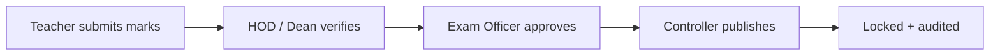
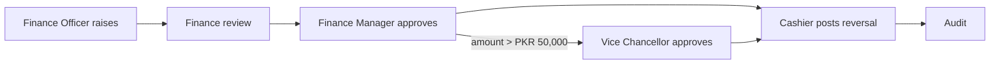

# UMS Governance & Role Architecture

**University Management System (UMS)** — a role-based, institution-wide management system.
Each university office, faculty, department and user works inside its own authority.
The system administrator runs the software; university officials run the university.

> A web application is only *how* UMS is delivered. The system itself is the University Management System.

## 1. Why there is no "one Admin does everything"

| Question | Answer in UMS |
|---|---|
| Can the System Administrator approve admissions / publish results / approve refunds? | Only through **Emergency Access**: a written reason, a window of at most 60 minutes, automatic expiry, full audit - and only while *nobody* holds that office. Once a Registrar / Controller / Finance Manager is assigned, the System Administrator is refused (`governance.permissions.authority_perm`). |
| Can one person hold conflicting duties? | No. Separation-of-duties rules (`SOD_RULES`) block the assignment, block a role that bundles them, and a report lists any legacy violations. |
| Can a person approve their own request? | No (maker ≠ checker), and nobody can decide two stages of the same request. |
| Is `is_staff` a master key? | No. Staff status grants nothing; only an explicit role assignment does. |
| Can a teacher touch another teacher's marks? | No. Teachers are limited to sections they are assigned to. |
| Is Parent/Guardian a core role? | No. Guardian details live on the student record. A guardian login is an optional extension (Site Settings → *Enable guardian portal*, off by default). |

## 2. Layers of authorization

```
User → Role → Permission (module + action) → Scope (university / faculty / department / program)
     → Object ownership (teacher↔section, student↔own record) → Workflow state → Action → Audit log
```

## 3. Offices and roles (installed by `manage.py seed_roles` / migration)

| Office | Roles |
|---|---|
| University Governance | Chancellor/Chairman, Vice Chancellor/Rector, Pro Vice Chancellor — oversight + escalated approvals, **no CRUD** |
| Registrar's Office | Registrar, Academic Administrator |
| Faculty / Department | Dean (faculty scope), Head of Department, Department Coordinator (department scope) |
| Admissions | Admission Officer (verifies), Admission Committee (selects / rejects / publishes offers) |
| Examination | Examination Officer (exam-office approval), Controller of Examinations (publishes, reopens) |
| Finance | Finance Officer (raises/reconciles), Finance Manager (approves/voids), Cashier (receives) |
| HR & Payroll | HR Officer, Payroll Officer (prepares), HR Manager (approves) |
| Campus Services | Librarian, Hostel Officer, Transport Officer, Student Affairs Officer |
| IT & Security | IT/System Administrator, Security Administrator — **no authority over admissions, results or money** |
| Audit | Auditor (read-only) |
| Operational | Teacher (own sections only), Student (own records only) |

The full role × module matrix is live at **/governance/matrix/**, the organisation chart and lifecycle
diagrams at **/governance/map/**, and every user can see their own rights at **/governance/my-access/**.

## 4. Approval workflows





| Request | Stages (permission) |
|---|---|
| Marks correction (after submission) | Department review (`results.verify`) → Controller (`results.override`) |
| Fee adjustment | Finance review (`finance.reconcile`) → Finance Manager (`finance.approve`) |
| Refund | Finance review → Finance Manager → Vice Chancellor if above the limit (`executive.approve`) |
| Registration exception / other | Registrar (`registration.approve`) |
| Result publication | HOD/Dean `verify` → Exam Officer `approve` → Controller `publish` (three different people) |
| Grade correction after publication | Controller (`results.override`) |

Refund approval records the decision only; the cashier posts the reversal, so money never moves from one click.

## 5. Separation-of-duties rules (`governance/constants.py → SOD_RULES`)

* IT/security administration ≠ admissions, results or finance authority
* Admission selection ≠ examination results
* Result verification, exam-office approval and publication are three different people
* Whoever raises finance documents ≠ whoever approves refunds / waivers
* Payroll preparation ≠ payroll approval
* Course/curriculum approval ≠ finance

## 6. Upgrading an existing database

`python manage.py migrate && python manage.py seed_roles`. The upgrade migration changes the four roles whose
duties were split (Registrar, Admission Officer, Exam Controller, Finance Officer) **only if they still have the
original default permissions**; any role you customised is left untouched. Users who now hold conflicting duties
appear under **Permission Matrix → Current violations**.

## 7. Supervisor Q&A

* *"Is this just a Django admin panel?"* — No: offices, scoped roles, object-level checks, multi-person approvals and an audit trail.
* *"Why is there no parent login?"* — Students are adults; guardian data is on the student record; a portal is optional.
* *"Why is it called UMS and not Web App?"* — The web is the delivery platform; the product is a University Management System.
* *"Where are the diagrams?"* — `/governance/map/` (live data) and the diagrams above.


## 8. Academic source of truth

`Student.program` is only a display cache. All academic, finance, registration and exam logic resolves the program through the
**active Enrollment** (`Student.active_program`), and exams are offered only for courses the student is actually registered in:

```
Student -> Active Enrollment -> Program -> Pinned Curriculum -> Academic Position -> Course Registration -> Registered Section -> Exam Session
```

The data-quality scan reports any student whose `program` column disagrees with their active enrollment.

## 9. Object-level access (anti-IDOR)

Hiding a button is not security. Views that take an id call `core.permissions`:

| Helper | Rule |
|---|---|
| `can_manage_section(user, section, write)` | write: only the section's own teacher; read: also an office holder whose `sections` permission covers that program/department |
| `teaches_grade(user, grade)` | a teacher edits marks only for students registered in *their* section, not any section of the same course |
| `can_view_student(user, student, module)` | own record; verified guardian; teacher of that student; or an office role holding `module.view` for that program. The IT administrator gets nothing automatically |

`core/tests_idor.py` is the matrix: Teacher B against Teacher A's section, a student against another student, and Finance / IT /
Admission officers against academic records - all must get 403/404.

## 10. Who can create which accounts (`/governance/provision/`)

| Holder of | May create accounts for |
|---|---|
| IT / Security admin (`security.create`) | IT Administrator, Security Administrator |
| Vice Chancellor / Chancellor (`executive.approve`) | Chancellor, VC, Pro VC, Registrar, Dean, Controller, Finance Manager, HR Manager, Auditor |
| Registrar (`registration.approve`) | HOD, Department Coordinator, Academic Administrator |
| Finance Manager | Finance Officer, Cashier |
| Controller of Examinations | Examination Officer |
| Admission Committee | Admission Officer |
| HR Manager | HR Officer, Payroll Officer, Librarian, Hostel / Transport / Student Affairs Officer, Admission Committee |

Creating an account never gives authority over that person's work; new accounts get no Django `is_staff` / `is_superuser` flag.
The System Administrator's own account-creation page (Security Center) is the bootstrap path for the very first office holders.

## 11. Bulk student import / export

`/students/import/` checks the whole CSV first and lists every problem by line; nothing is saved until all rows are valid and the operator confirms,
and then everything is written in one transaction. Each row needs `students.create` (new) or `students.edit` (existing) for that row's program.
An import never changes an existing student's program (use the enrollment workflow) and never invents passwords. Export (`students.export`) returns only
students in the user's scope, neutralises spreadsheet formulas, and both actions are audit-logged.
